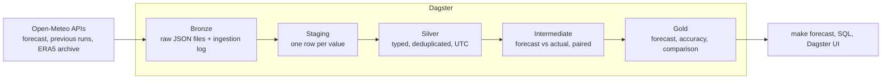

# Open-Meteo Weather Pipeline

An end to end, fully local data pipeline on the [Open-Meteo](https://open-meteo.com/en/docs) API, built with a medallion architecture (bronze, silver, gold) for 12 Australian locations.

It answers four questions:

1. What is the forecast for each location for the next 7 days?
2. How accurate were past forecasts, compared with what actually happened?
3. How does accuracy change as the forecast looks further ahead (1 to 7 days)?
4. Which of two forecast models, ECMWF or NOAA GFS, is more accurate?

Stack: Python (ingestion), DuckDB (storage), dbt (transformations and data tests), Dagster (orchestration), uv (environment). No cloud services, no Docker, no API key.

---

## Quick start

```bash
git clone https://github.com/Narayanprasai/open-meteo-medallion.git
cd open-meteo-medallion
make setup      # install Python 3.12 and all dependencies (1 to 2 minutes)
make test       # 26 offline tests
make backfill   # download 12 months of history and build every table (10 to 15 minutes)
make forecast   # print the 7 day outlook for Sydney
make ui         # open the pipeline in Dagster at http://localhost:3000
```

Details, expected output and troubleshooting for each step are below.

---

## Prerequisites

| Requirement | Notes |
|---|---|
| macOS or Linux | On Windows, use WSL (Ubuntu) |
| [uv](https://docs.astral.sh/uv/) | `curl -LsSf https://astral.sh/uv/install.sh \| sh`, then open a new terminal. uv installs the right Python (3.12) by itself |
| `make` and `git` | Preinstalled on macOS (Xcode command line tools) and most Linux distributions |
| Internet access | Only for downloading weather data from Open-Meteo (free, no key) |
| About 1 GB of disk | Dependencies ~700 MB, data ~40 MB per year |
| 8 GB of RAM is enough | DuckDB is capped at 2 GB |

---

## Step by step

Run every command from the repository root.

### 1. Install

```bash
make setup
```

Creates `.venv/` with Python 3.12 and every dependency from `uv.lock`, so versions match exactly.

### 2. Run the tests (no internet needed)

```bash
make test
```

Expected: `26 passed`. These run the ingester against a fake API (retries, duplicates, failures, safe reruns) and check the Dagster setup.

### 3. Download history and build everything

```bash
make backfill
```

This does two things:

1. Downloads past forecasts (made 1 to 7 days ahead) and ERA5 actual weather from 1 Oct 2025 to today, one month per request, with a short pause between requests to respect the free API. Expect one `stored` line per month for each of `previous_runs` and `actuals`.
2. Runs the daily pipeline through Dagster: the live 7 day forecast, then every dbt model and data test. Expect `Done. PASS=82` from dbt and `RUN_SUCCESS` from Dagster.

To backfill a different period: `make backfill BACKFILL_START=2025-01-01`. Interrupted or failed? Run the same command again: months already downloaded are skipped, only missing ones are fetched.

### 4. Look at the results

```bash
make forecast              # Sydney
make forecast LOC=per      # Perth; location ids are in config/locations.yaml
```

Example output (columns trimmed):

```
model         local_date  lead_day  tmin  tmax  err  rain_mm  weather_description
ecmwf_ifs025  2026-10-16  2         13.3  17.5  2.2  8.1      Moderate drizzle
gfs_global    2026-10-16  2         15.1  19.4  1.3  1.6      Light drizzle
```

`err` is how far off that model's daily maximum has typically been at this location for that many days ahead, taken from its own history.

Headline accuracy table:

```bash
uv run python -c "import duckdb; c=duckdb.connect('data/warehouse.duckdb', read_only=True); print(c.sql(\"select lead_day, model, round(mae,2) mae_c, round(share_within_2,2) within_2c from gold.gold_daily_accuracy where metric='temperature_max' and location_id='ALL' and season='all' order by lead_day, model\"))"
```

Any SQL client that reads DuckDB files (DBeaver, the `duckdb` CLI) can open `data/warehouse.duckdb`. Tables are in schemas `bronze`, `staging`, `silver`, `intermediate` and `gold`.

### 5. Daily use

```bash
make run      # fetch the newest forecast and recent actuals, rebuild and test everything (2 to 3 minutes)
make ui       # Dagster UI at http://localhost:3000
```

In the UI: **Assets** shows the lineage graph from bronze to gold, **Runs** shows history, and **Automation** has the `daily_refresh_schedule` (07:30 Sydney time). The schedule ships switched off; turn it on there if you want daily runs while the UI is running.

### Without make

```bash
uv sync
uv run pytest
uv run python -m weather_pipeline.ingest --source previous_runs actuals --start 2025-10-01   # end defaults to today
uv run python -m weather_pipeline.ingest                                                      # live forecast + last 10 days
uv run dbt build --project-dir dbt --profiles-dir dbt                                         # all models and data tests
DAGSTER_HOME=$PWD/.dagster uv run dagster dev                                                 # orchestration UI
```

---

## Architecture



* **Bronze** (Python, `src/weather_pipeline/ingest/`): every API response is saved unchanged as a JSON file, and every request, including failures, is logged in `bronze.ingestion_log`. Reruns are safe: a response already stored for the same request is not written again.
* **Silver and gold** (dbt, `dbt/models/`): SQL models that unpack, clean, join and score the data. 82 data tests run on every build.
* **Orchestration** (Dagster, `src/weather_pipeline/orchestration/`): one asset graph grouped by layer; dbt tests show as checks on each table. If any download fails, downstream tables are not rebuilt on partial data.

### Data model

| Layer | Object | One row per |
|---|---|---|
| Bronze | `data/bronze/<source>/ingest_date=*/*.json`, `bronze.ingestion_log`, `bronze.locations` | API request |
| Staging | `staging.stg_bronze__hourly_values` | source, location, model, variable, lead day, hour |
| Silver | `silver.silver_forecast_by_lead` | location, model, hour (UTC), lead day 1 to 7 |
| Silver | `silver.silver_actuals` | location, hour (UTC), from ERA5 |
| Silver | `silver.silver_forecast_current` | location, model, hour (UTC), latest live forecast |
| Silver | `silver.silver_coverage`, `silver.dim_location`, `silver.weather_codes` | completeness report; locations with timezone; weather code labels |
| Intermediate | `intermediate.int_hourly_errors` | forecast vs actual per hour, both models on identical hours |
| Intermediate | `intermediate.int_daily_errors` | complete local days only (23, 24 or 25 hours with daylight saving) |
| Gold | `gold.gold_forecast_7day` | location, model, local date: outlook with expected error |
| Gold | `gold.gold_accuracy_by_lead` | model, variable, lead day, location (`ALL` or one) |
| Gold | `gold.gold_daily_accuracy` | model, metric (daily max/min temperature, rain, peak wind), lead day, location, season |
| Gold | `gold.gold_rain_skill` | model, lead day, location: share of rain days caught, false alarms |
| Gold | `gold.gold_model_comparison` | variable, lead day, location: which model is more accurate |
| Gold | `gold.gold_pipeline_health` | data source: freshness, latest ERA5 hour, failures |

### Key design decisions

* **UTC until gold.** Australia has five UTC offsets and only some states use daylight saving. Everything is stored in UTC and converted to local time only in gold, using each location's timezone. A test checks known 23 and 25 hour days.
* **Models pinned, not "best match".** Best match can switch models between lead days and distort the accuracy curve.
* **Independent truth.** Actuals come from ERA5 reanalysis, explicitly pinned: the archive's default mixes forecasts into recent days.
* **Fair comparison.** An hour is scored only if both models and the actual exist, so gaps in one model's archive cannot tilt the result.
* **Tested assumptions first.** `scripts/probe_api.py` checked models, lead days, history depth, variables and request size against the live API before any pipeline code was written.
* **Config driven.** Locations, models, variables and dates live in `config/`; nothing is hardcoded.

---

## Results (1 Oct 2025 to 14 Oct 2026)

| Question | Answer |
|---|---|
| How accurate? | ECMWF daily maximum temperature is off by 1.2 °C on average one day ahead; 83% of days within 2 °C |
| Further ahead | ECMWF 1.2 °C at day 1 rising to 2.2 °C at day 7 (58% within 2 °C); GFS 1.4 °C to 2.4 °C |
| Which model? | ECMWF has the lower error at every lead day nationally (see the truth caveat below) |
| Rain | ECMWF catches 86% of rain days one day ahead but forecasts rain slightly too often; GFS catches 46% of rain days at day 7 |
| Local differences | ECMWF forecasts Sydney's maximum ~2 °C too cold and Perth's ~2 °C too warm; in Sydney GFS is the better model |

Numbers change slightly with every run as new actuals arrive.

---

## Testing

Two kinds of tests:

* **Python tests** (`tests/`, `make test`): run the ingester and Dagster setup against a fake API. Examples: a busy server is retried, a bad request is not, a second run stores no duplicate, a failed month does not stop the others.
* **Data tests** (`dbt/`, run by every `dbt build`): SQL checks on the tables. Examples: no duplicate rows, every location present, temperatures within −20 to 55 °C, Sydney has a 23 hour day on 5 Oct 2025, both models scored on the same hours.

---

## Troubleshooting

| Problem | Fix |
|---|---|
| `uv: command not found` after installing | Open a new terminal, or run `export PATH="$HOME/.local/bin:$PATH"` |
| `make setup` is slow and compiles packages | Python version is pinned to 3.12 in `.python-version`; make sure that file is present |
| Some months `failed` during the backfill | Usually a temporary API problem. Run the same command again; only missing months are fetched |
| HTTP 429 (too many requests) | Free tier limit. Wait a few minutes and rerun |
| `Out of Memory` in dbt | Lower or raise the cap: `DUCKDB_MEMORY_LIMIT=1GB make build` |
| `Could not set lock on file ... warehouse.duckdb` | Another program has the database open (SQL client, Python shell). Close it and retry |
| Dagster UI does not show a model change | Restart `make ui`; it rebuilds the dbt manifest on start |
| `make forecast` shows yesterday as lead day 0 | The live forecast is from the last run; run `make run` |

---

## Known limitations

* Truth is ERA5 reanalysis, not weather station observations. ERA5 is produced by ECMWF on the same 0.25° grid as `ecmwf_ifs025`, which likely favours ECMWF in the comparison.
* BOM's own model (ACCESS) returns no data for these locations through Open-Meteo, so it could not be included.
* Open-Meteo's ECMWF archive is missing three columns for 17 to 22 April 2026 (see `silver.silver_coverage`). Those hours are excluded for both models.
* Forecasts are for the model grid point nearest each city. The large Sydney and Perth biases are likely coastal grid effects; not yet verified.
* A "day N" daily value combines hourly forecasts from model runs a few hours apart.
* No state level rollup: averaging Perth with Broome would be meaningless, so results are per location with a `state` column.

---

## Repository layout

```
config/                  locations and pipeline settings (edit these, not the code)
src/weather_pipeline/
  ingest/                bronze: API client, request building, raw storage, CLI
  orchestration/         Dagster definitions
dbt/
  models/                staging, silver, intermediate, gold
  tests/                 data tests
scripts/probe_api.py     API investigation used to choose models and settings
tests/                   Python tests
docs/ai_log.md           decision log, including AI mistakes and how they were caught
docs/screenshots/        AI conversation evidence
.claude/skills/          knowledge transfer guide for engineers and AI agents
CLAUDE.md                short rules for AI assistants working in this repo
data/                    downloaded data and DuckDB warehouse (created locally, not in git)
```

To add a location, append it to `config/locations.yaml` and run `make backfill`. See [the skill guide](.claude/skills/weather-pipeline/SKILL.md) for adding variables or models.

---

## AI usage

AI (Claude) was used as a pair engineer for design discussion, code, SQL and review. The AI could not reach the Open-Meteo API from its environment, which set the working pattern: the AI wrote code and tested it against mocked responses, I ran every probe, backfill and build on my own machine, and the real results decided the next step.

What I did: set the goals (Australian locations, 7 day forecast, accuracy by lead day, comparing two models), questioned the design, ran and judged every probe and backfill, reported failures from my machine, and reviewed and committed each step.

| Screenshot | Conversation |
|---|---|
| [01_architecture](docs/screenshots/01_architecture.png) | My brief and the proposed medallion architecture |
| [01b_tool_choice](docs/screenshots/01b_tool_choice.png) | Why DuckDB and dbt, and Dagster over Airflow, for a local build |
| [02_goals_and_api](docs/screenshots/02_goals_and_api.png) | My goals for the project; the AI found the Previous Runs API that makes accuracy by lead day possible |
| [03_design_feedback](docs/screenshots/03_design_feedback.png) | My bronze/silver/gold outline, and the AI's changes so no forecast data is lost |
| [04_probe_approach](docs/screenshots/04_probe_approach.png) | Testing the API before building the pipeline |
| [05_model_choice](docs/screenshots/05_model_choice.png) | I questioned how the models were chosen and how accuracy is measured |
| [06_accuracy_method](docs/screenshots/06_accuracy_method.png) | How forecasts are matched with actuals and scored by lead day |

The full decision log, including problems found while running on real data (archive values in the future, an API returning empty responses, running out of memory on an 8 GB laptop) and how each was fixed, is in [`docs/ai_log.md`](docs/ai_log.md).
